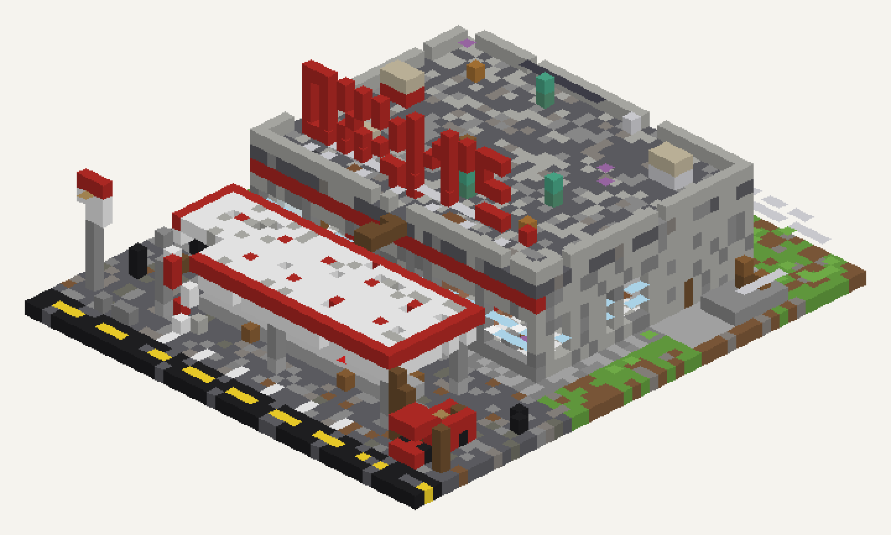

# AXON-Structure

Plugin na serwer **Paper 1.21.4** (Java 21), który jedną komendą wkleja do świata struktury w stylu monumentów z gry Rust.



## Komendy

| Komenda | Opis |
| --- | --- |
| `/struktury` | pomoc |
| `/struktury lista` | lista dostępnych struktur |
| `/struktury wklej <nazwa> [ziarno]` | wkleja strukturę przed graczem, frontem w jego stronę |
| `/struktury cofnij` | cofa ostatnie wklejenie (pamięta 5 ostatnich na gracza) |

Alias: `/axs`. Uprawnienie: `axonstructure.use` (domyślnie OP).

Struktura jest generowana w kodzie (bez plików schematic). Każde wklejenie jest trochę inne (zniszczenia, loot), a podanie tego samego `ziarna` daje identyczny wynik. Bloki stawiane są partiami po 4000 na tick, a teren pod spodem jest dosypywany, żeby budynek nie wisiał nad zboczem.

## Struktury

### `stacja` – Opuszczona stacja benzynowa (Oxum's Gas Station, Tier 0)

Rozmiar: 45 × 52 bloki, 16 w górę.

- **Plac przed sklepem:** zadaszona wiata z 3 dystrybutorami (jeden przewrócony, róg wiaty zawalony), czerwone beczki paliwa i beczki ze złomem, pickup z beczką na pace, wrak auta, opony, znaki, pylon z cennikiem.
- **Sala sklepowa:** wybite witryny, wyrwane drzwi, lada kasowa z **zieloną kartą dostępu** w ramce na blacie, skrzynka z jedzeniem obok lady, telefon na ścianie, pordzewiałe regały (jeden przewrócony), skrzynie w alejkach, rząd zniszczonych lodówek ze skrzynką medyczną.
- **Zaplecze:** korytarz, dwie toalety ze skrzynkami, pokój z drabiną na dach, magazyn z **recyklerem** (atrapa z bloków) i regałami z brązową skrzynią, dwa tylne wyjścia: na śmietnik i na boczną rampę.
- **Dach:** klimatyzatory, wywietrzniki, szyld OXUM'S, 1–3 skrzynie. Wejście drabiną od środka albo z zewnątrz: pickup → skrzynie → dach wiaty → deski → dach budynku.

Pojemniki z Rusta to skrzynie i beczki z nazwą i lootem: beczka, beczka paliwa (ze świeczką na wieku), brązowa skrzynia, skrzynka z jedzeniem, skrzynka medyczna, skrzynka narzędziowa.

## Budowanie

```bash
./gradlew build
```

Gotowy plik: `build/libs/AXON-Structure-<wersja>.jar`. Każdy push buduje go też w GitHub Actions (artefakt `AXON-Structure`).
